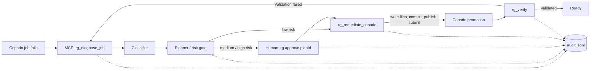

# Release Guardian

Governed failure diagnosis and remediation for Salesforce releases on Copado, exposed as an MCP server plus a small CLI.
Copado stays the system of record (pipelines, gates, promotions). Release Guardian adds failure triage, a risk-scored plan,
a human approval gate for anything risky, and an audit trail.

## Architecture

## Requirements

- Node.js and npm
- A Copado org with the Agentia CLI (`agentia`) installed and authenticated (`agentia setup`)
- A clone of the Salesforce repo that Copado promotes from; set `RG_PROJECT_DIR` to it
- An MCP client such as Cursor or Claude Code

## Setup

    npm install && npm run build
    npm test            # readiness / approval-gate unit test

MCP config (Cursor / Claude Code):

    { "mcpServers": { "release-guardian": {
        "command": "node", "args": ["C:/abs/path/release-guardian/dist/server.js"],
        "env": { "RG_PROJECT_DIR": "C:/abs/path/sfdx-repo" } } } }

State (`audit.jsonl`, `plans.json`, approvals) lives in `<package>/.guardian` by default, so the MCP server and the CLI
always agree regardless of their working directory. Override with `GUARDIAN_DIR` (absolute path).

## Tools

| Tool | Purpose |
|---|---|
| `rg_diagnose` | Classify a pasted log, return a plan (read-only) |
| `rg_diagnose_job` | Diagnose a Copado job/promotion; target env comes from Copado, `targetEnv` can only make the plan stricter |
| `rg_remediate_copado` | Write files on `feature/<story>`, commit, `work publish`, `work submit`. Target comes from the plan. Gated |
| `rg_verify` | Check a promotion. `promotionReady` needs Validated + successful deploy + planned target + approval if required |
| `rg_remediate` | Local `sf` CLI path (patch + targeted tests), target = plan's env alias. Gated |
| `rg_report` | Audit trail and per-promotion readiness (latest promotion decides) |

Publish plus submit can take several minutes, longer than most MCP clients wait, so the call may time out even though the
submission succeeded. Calling `rg_remediate_copado` again with the same plan is safe: it returns `already_submitted` with the
existing `promotionId` and creates no duplicate promotion. `rg_report` shows the same `submitted` event.

## Human approval (out-of-band)

    node dist/cli.js plans
    node dist/cli.js approve <planId>
    node dist/cli.js report [planId]

## Governance rules

- Non-production + non-destructive + classified = low risk, the agent may proceed.
- Production, destructive changes, permission changes, unclassified failures = approval required.
- `rg_remediate_copado` only writes relative paths under `force-app/`.
- After submit, Copado's destination is compared with the plan's target; a mismatch is audited and never marked ready.

## Demo results (Copado trial org, pipeline Dev1 -> INT -> UAT -> Production)

| Scenario | Outcome |
|---|---|
| Apex class referencing a missing field (`Account.Segment__c`), validation into INT-SFP failed | Agent diagnosed `MISSING_DEPENDENCY` (low risk), wrote the field with `rg_remediate_copado`, and promotion P00014 reached Validated |
| `rg_remediate_copado` call timed out in the client | Agent recovered the `promotionId` from `rg_report` instead of retrying |
| Same call repeated for the same plan | Returned `already_submitted` with the same promotion; no duplicate created |
| Same Apex failure with a Production target | Plan risk `high`; `rg_remediate` returned `awaiting_approval` until a human ran `rg approve`, then the dry run succeeded |

## Known limitations

- Approval is a file written by `rg approve`. No MCP tool can create it, but an agent with shell access could run the CLI.
- The classifier is regex-based; an LLM fallback for `UNKNOWN` failures is not implemented.
- `rg_diagnose_job` finds the job through `agentia cicd work status` (pass `story`, or it uses the last work item set), so `RG_PROJECT_DIR` must point at the sfdx repo.
- `rg_remediate_copado` stops if `work set <story>` fails, because publish and submit act on the recorded work item.
